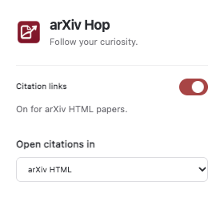

# arXiv Hop

Follow your curiosity.

Click citations in arXiv HTML papers to open the cited paper in a new tab. Hover over missing links to look up matching titles on arXiv; otherwise search Google.

[Download extension](https://github.com/JeffryCA/arxiv-hop/releases/latest)

**Install:** Download and unzip the release ZIP. In Comet/Chrome, open `chrome://extensions`, enable Developer mode, choose **Load unpacked**, and select the extracted `arxiv-hop` folder. Reload your paper.

**Options:** Click the toolbar icon to toggle citation links or choose HTML (default), PDF, or abstract. Choices persist and update open papers immediately. Alt-click for the bibliography. HTML availability varies by paper.

**PDF downloads:** **View PDF** opens the PDF viewer. Click **Download PDF** in an HTML paper to save the file. PDFs go to browser Downloads by default. Turn off **Ask where to save each file before downloading** for automatic saves there. Under **PDF downloads**, pick a folder or choose paper titles or arXiv IDs for filenames. A chosen folder silently skips duplicates. If access expires, use **Reconnect folder**.

Dependency-free; no backend or tracking. Hover lookups contact arXiv's public API; results are cached locally for a day. Matches tolerate typography differences, never partial titles. Stores your preferences and a small cache.

Thank you to arXiv for use of its open access interoperability.

**Test:** `node --test tests/*.test.cjs`

https://github.com/user-attachments/assets/90fa62bf-6e2c-47ec-9d84-183255b5bbec
